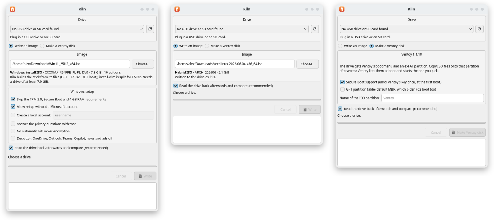

<p align="center">
  
</p>

<h1 align="center">Kiln</h1>

<p align="center">
  <b>Bootable USB sticks, done right, on Linux, Windows and macOS.</b><br>
  Verified image writes, Windows 11 install sticks with Rufus-style tweaks, and Ventoy disks.
</p>

<p align="center">
  <a href="https://github.com/TryCoffee/kiln/releases/latest"></a>
  <a href="https://github.com/TryCoffee/kiln/releases"></a>
  <a href="https://github.com/TryCoffee/kiln/actions/workflows/packages.yml"></a>
  <a href="LICENSE"></a>
</p>

<p align="center">
  <a href="https://github.com/TryCoffee/kiln/releases/latest"></a>
  <a href="https://github.com/TryCoffee/kiln/releases/latest"></a>
  <a href="https://github.com/TryCoffee/kiln/releases/latest"></a>
  <br>
  <a href="https://kiln-usb.pages.dev"><b>kiln-usb.pages.dev</b></a>
  <br>
  <sub>Windows 10 (1903) or newer, x64 · macOS 14.4 or newer, Apple silicon · Arch, Debian 13, Ubuntu 26.04, Fedora 44 · free software, GPL v3</sub>
</p>

<p align="center">
  
</p>

Pick a stick, pick an image, press Write. Kiln writes it, then reads every byte back to prove it landed. A Windows ISO becomes a proper install stick, with the setup tweaks you would otherwise go looking for. And if you would rather carry every ISO you own on one stick, Kiln makes it a Ventoy disk.

<table>
  <tr>
    <td width="33%" valign="top">
      <h3>Any image, verified</h3>
      Linux ISOs and disk images are written byte for byte and read back. Give it the SHA-256 and the image is checked before a single byte is written.
    </td>
    <td width="33%" valign="top">
      <h3>Windows 11, your way</h3>
      Built from the ISO's files with UEFI boot and Secure Boot left on. Skip the TPM, Secure Boot and RAM checks, use a local account, and switch off BitLocker, OneDrive, Copilot and ads.
    </td>
    <td width="33%" valign="top">
      <h3>Ventoy disks</h3>
      One stick, every ISO: Kiln lays out a <a href="https://www.ventoy.net">Ventoy</a> 1.1.18 disk exactly as Ventoy's own installer does, MBR or GPT, with Secure Boot support if you want it.
    </td>
  </tr>
</table>

> [!IMPORTANT]
> **Kiln only ever offers USB drives, SD cards and removable drives.** The disks your system runs from, internal disks and the drive the image is on are never in the list. Still: it erases the whole drive you pick, so check the name before you write. Kiln is early software, so keep backups.

## What makes it different

- **It checks its own work.** Every write is read back and compared, every file of a Windows stick too. A mismatch is reported down to the first differing byte.
- **It refuses the dangerous choices.** System disks are found by following mounts through dm-crypt, LVM, md and APFS down to the physical disk, not by guessing from the size. `kiln list --all` shows every disk and why it was left out.
- **Only the write runs as administrator.** The window you click in never does. On Linux a small helper starts through polkit and checks the drive list again itself; on Windows it runs through UAC with your own rights for everything but the drive; on macOS nothing runs as root at all, the system's own dialog hands Kiln access to that one drive.
- **The same app everywhere.** One codebase, the same features, a GUI and a command line on all three systems.

## Install

Every [release](https://github.com/TryCoffee/kiln/releases/latest) carries packages for all three systems, a `SHA256SUMS` file, and the source of Kiln and of every GPL and LGPL component built into it.

<details>
<summary><b>Windows</b>: installer or portable zip</summary>

<br>

For 64-bit Windows 10 (1903) or newer:

- `Kiln-VERSION-x64-setup.exe` installs Kiln into Program Files with a Start menu entry and an uninstaller;
- `Kiln-VERSION-x64.zip` is the same files to unpack anywhere and run from there.

Kiln is not code-signed, so SmartScreen warns before the first start: choose **More info**, then **Run anyway**. Writing a drive asks for administrator rights (UAC) each time.

The command line is `kiln.exe` in the same folder. To write a drive it needs a terminal opened with **Run as administrator**:

```
"C:\Program Files\Kiln\kiln.exe" list
```

</details>

<details>
<summary><b>macOS</b>: disk image for Apple silicon</summary>

<br>

`Kiln-VERSION-arm64.dmg`, for Macs with Apple silicon on macOS 14.4 or newer. Open it and drag Kiln to Applications.

Kiln is not signed with an Apple Developer ID, so macOS refuses the first start of a downloaded copy. To allow it once: try to open Kiln, then in **System Settings > Privacy & Security** choose **Open Anyway**.

The command line is inside the app:

```sh
/Applications/Kiln.app/Contents/Helpers/kiln list
sudo ln -s /Applications/Kiln.app/Contents/Helpers/kiln /usr/local/bin/kiln   # optional
```

</details>

<details>
<summary><b>Linux</b>: Arch, Debian, Ubuntu, Fedora</summary>

<br>

Packages for x86_64. Each installs `kiln`, `kiln-gui`, the helper and its polkit rule, and pulls in Qt 6 and pkexec through your package manager.

| Distribution | Package | Install |
|---|---|---|
| Arch Linux, CachyOS | `kiln-VERSION-1-x86_64.pkg.tar.zst` | `sudo pacman -U kiln-*.pkg.tar.zst` |
| Debian 13, Ubuntu 26.04 | `kiln_VERSION_amd64.deb` | `sudo apt install ./kiln_*_amd64.deb` |
| Fedora 44 | `kiln-VERSION-1.x86_64.rpm` | `sudo dnf install ./kiln-*.x86_64.rpm` |

The Arch package is built from `packaging/arch/PKGBUILD`, which also works with `makepkg` on its own.

</details>

## On every system

| | Linux | Windows | macOS |
|---|:---:|:---:|:---:|
| Raw write + verify | ✓ | ✓ | ✓ |
| Windows 11 install sticks + tweaks | ✓ | ✓ | ✓ |
| Ventoy disks | ✓ | ✓ | ✓ |
| GUI and command line | ✓ | ✓ | ✓ |
| Admin prompt | polkit | UAC | macOS's own dialog |
| Packages | Arch, Debian/Ubuntu, Fedora | installer, zip | DMG |

## Command line

```sh
kiln list                     # drives Kiln will write to
kiln list --all               # every disk, and why the others are left out
kiln info image.iso [--sha256]
sudo kiln write image.iso sdc [--sha256 HEX] [--unmount] [--no-verify]
kiln verify image.iso sdc
sudo kiln ventoy sdc [--gpt] [--no-secure-boot] [--label NAME] [--reserve MIB]
```

`kiln write` asks you to type the drive's name before it erases anything (`--yes` skips that, for scripts). On Windows a drive is named like `PhysicalDrive2`; on macOS like `disk4`.

<details>
<summary><b>Windows install sticks and setup tweaks</b></summary>

<br>

`kiln write` recognises a Windows ISO and builds the stick instead of copying it: GPT, FAT32, UEFI boot, `install.wim` split into `.swm` parts when it is over 4 GiB, every file read back. `kiln info win.iso` lists the editions and the smallest stick that fits. For Windows 11 25H2 that is 7.9 GiB, so most "8 GB" sticks (7.45 GiB) are too small. Splitting `install.wim` needs about that much free space in a temporary folder (`--temp-dir DIR` to choose it). Legacy BIOS boot is not supported for Windows sticks.

```sh
sudo kiln write win11.iso sdc --bypass-checks --no-ms-account --local-account alex
```

| option | what it does |
|---|---|
| `--bypass-checks` | no TPM 2.0, Secure Boot or 4 GB RAM requirement |
| `--no-ms-account` | Setup offers an offline account |
| `--local-account NAME` | creates local administrator NAME with an empty password, to be changed at first sign-in |
| `--no-data-collection` | privacy questions answered "no", licence page skipped |
| `--no-bitlocker` | no automatic device encryption |
| `--declutter` | OneDrive, Outlook, Teams, Copilot, news and ads off; classic context menu |

The bypass is for clean installs started from the stick. Upgrading a running Windows 11 in place with it is not supported.

</details>

<details>
<summary><b>Ventoy disks, raw writes, testing without a stick</b></summary>

<br>

**Ventoy.** Kiln lays the disk out the way Ventoy's own installer does. The partition tables are written last, so a write that fails or is cancelled leaves a drive with no partitions, not a half-made Ventoy disk. Not done yet: updating Ventoy on an existing disk while keeping the ISOs, and copying ISO files on from Kiln.

**Raw writes.** A raw write only boots when the image carries its own partition table (most Linux ISOs and disk images do). Anything else is refused; `--force` writes it anyway.

**Without a stick.** `--to-file` writes into an image file instead of a drive, which you can then boot in QEMU:

```sh
truncate -s 8G stick.img
kiln write archlinux.iso --to-file stick.img
qemu-system-x86_64 -enable-kvm -m 2G -device usb-ehci,id=ehci \
    -drive file=stick.img,format=raw,if=none,id=usb \
    -device usb-storage,bus=ehci.0,drive=usb,bootindex=0
```

A Windows stick needs a bigger file (`truncate -s 16G`) and UEFI (OVMF) with `-machine q35 -cpu host -m 4G`. Use the EHCI controller as above: with QEMU's xHCI the Windows boot manager sometimes stalls or fails with 0xc0000428, for any stick.

</details>

<details>
<summary><b>What Kiln will never write to</b></summary>

<br>

- **Linux:** only USB-attached drives, SD cards and drives the kernel flags as removable. A disk holding `/`, `/boot`, `/home`, `/usr`, `/var` (and a few more) or swap is never offered, followed through dm-crypt, LVM and md down to the physical disk. Internal disks are never offered, even when nothing on them is mounted.
- **Windows:** only USB drives, SD cards and removable media. Never virtual disks (VHD, Storage Spaces), internal disks, or any disk behind the Windows folder, the boot partition or a page file.
- **macOS:** only external USB drives and SD cards. Never internal disks, disk images, or the disk behind `/` or `/System/Volumes/*` (followed from an APFS container to its physical disk).
- **Everywhere:** never the drive the image itself is stored on.

</details>

## What has been tested

- **Linux:** an Arch Linux ISO written to a real USB stick, the stick's checksum equal to the ISO's. Windows 11 sticks and Ventoy disks built on virtual sticks and booted in QEMU; a full Windows 11 install from a tweaked stick on a virtual machine with no TPM, 3 GB of RAM and Secure Boot off, ending signed in to the local account.
- **Windows:** with the released program, on a virtual USB stick: an Arch Linux ISO written raw (read back equal to the ISO), a Windows 11 stick with every setup tweak, and a Ventoy disk, each checked from Linux; the installer installs, runs and uninstalls cleanly.
- **macOS (Apple silicon):** with the released app, on a real USB stick: an Arch Linux ISO written raw (read back equal to the ISO), a Windows 11 stick with every setup tweak, and a Ventoy disk, each checked with macOS's own tools.
- **Every release:** each Linux package is installed and started on fresh Debian, Ubuntu, Fedora and Arch systems by the build itself.

Not tested yet: a physical stick on Windows; the GUI's admin prompt on Windows (UAC) and macOS (`authopen`); a Ventoy disk on a machine with Secure Boot enforced; Intel Macs. [Bug reports](https://github.com/TryCoffee/kiln/issues) are welcome.

## Building

<details>
<summary><b>Build from source</b></summary>

<br>

Needs CMake 3.25+, a C/C++20 compiler whose C side knows C23's `#embed` (GCC 15+, Clang 19+; on Debian 13 use `-DCMAKE_C_COMPILER=clang-19`), `make` and `patch`, and Qt 6.4+ Widgets for the GUI (`-DKILN_GUI=OFF` builds without it). CMake builds libcdio 2.4.0, wimlib 1.14.5 and hivex 1.3.24 from source and takes three files from Ventoy 1.1.18's release, all pinned by SHA-256 (`cmake/third-party.cmake`).

```sh
cmake -S . -B build -G Ninja
cmake --build build
(cd build && ctest --output-on-failure)
sudo cmake --install build    # Linux: also installs the polkit policy
```

The first build downloads the third-party archives. To build offline, fetch them first and point the build at them:

```sh
cmake -DKILN_DOWNLOAD_DIR=deps -P cmake/fetch-third-party.cmake
cmake -S . -B build -G Ninja -DKILN_DOWNLOAD_DIR=deps
```

The tests use sfdisk, fsck.fat, mtools, fsck.exfat and xz as independent checkers; a missing tool marks a test skipped, not passed.

The release packages are built the same way:

- **Linux:** `packaging/linux/build.sh arch|debian|fedora`, offline in a container per distribution (needs Docker).
- **Windows:** `packaging/windows/make-installer.sh`, with Qt's official build for llvm-mingw and the llvm-mingw it was made with (`packaging/windows/fetch-toolchain.sh` downloads both, pinned), MSYS2 for the tools (CMake, Ninja, `make`, `patch`, Python) and Inno Setup 6. GNU libiconv is built from source there too.
- **macOS:** `packaging/macos/make-dmg.sh <qt>`, with Qt's official build (for example `aqt install-qt mac desktop 6.12.0 clang_64 --archives qtbase`).

</details>

## Third-party code

- FatFs R0.16 by ChaN, vendored in `third_party/fatfs/` (1-clause BSD-style).
- XZ Embedded by Lasse Collin, vendored in `third_party/xz-embedded/` (0BSD).
- Ventoy 1.1.18 by longpanda (GPL-3.0+): its `boot/boot.img`, `boot/core.img.xz` and `ventoy/ventoy.disk.img.xz`, unmodified from the official release, built into `kiln` and `kiln-helper`. The partition image also carries GRUB, shim, iPXE, wimboot and other parts under their own licences, listed in Ventoy's `License/` directory.
- wimlib 1.14.5 (GPL-3.0+ / LGPL-2.1+), built from source with a patch (`third_party/wimlib/`).
- hivex 1.3.24 (LGPL-2.1+), the library only, built from source.
- libcdio 2.4.0 (GPL-3.0+), built from source.
- GNU libiconv 1.19 (LGPL-2.1+), built from source, on Windows only.
- Qt 6 (LGPL-3.0): your distribution's on Linux; Qt's official build inside the macOS app and the Windows packages.
- Rufus (GPL-3.0+) is the reference for the Windows stick layout and setup tweaks; code ported from it (`src/unattend.cpp`) carries its attribution.

Every package carries these components' licence texts and `THIRD-PARTY-NOTICES.md`, which also says where their source is.

## Licence

Kiln is free software under the [GNU General Public License v3](LICENSE) or later.
